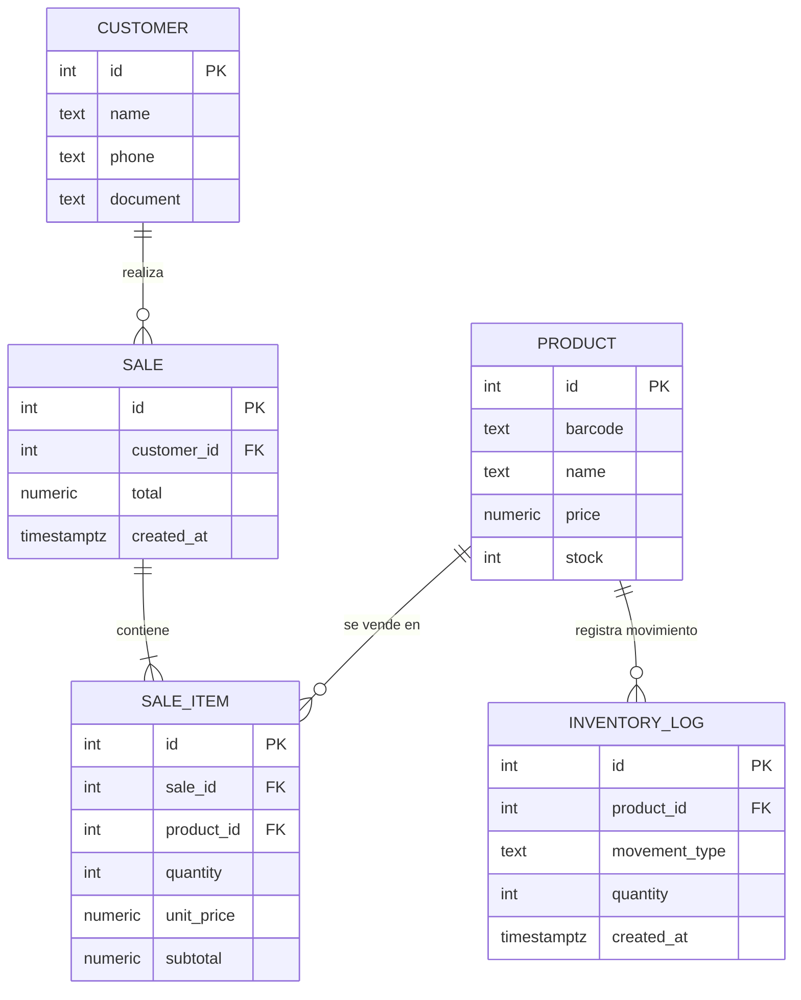

# PRD · Punto de Venta

> Documento de requisitos del producto (Product Requirements Document).
> Complétalo en el Sprint 0 (historia H0.3) y pide la aprobación del profesor en un Issue.
> Cada requisito funcional (RF) se convierte en un Issue con la plantilla "Historia de usuario".

| Campo | Valor |
| --- | --- |
| Alumno | Angel Rafael Jimenez Diaz |
| Proyecto n.º | Punto de Venta (Lector de código de barras + Tabla hash) |
| Sitio de referencia | Loyverse |
| Compañero revisor | Carlos |
| URL desplegada | (se completa en el Sprint 5) |

## 1. Problema

Las pequeñas bodegas y comercios locales suelen gestionar sus cobros, precios e inventario
de forma manual o con libretas de notas. Esto genera errores frecuentes en el cobro,
desabastecimiento imprevisto de productos de alta rotación, lentitud al atender al cliente
y falta de visibilidad sobre los ingresos y ganancias reales del negocio.

## 2. Usuarios

- **Usuario principal:** Cajero o dependiente del negocio. Necesita registrar ventas velozmente, buscar productos por código o nombre y totalizar pedidos sin errores desde un computador de escritorio o laptop.
- **Usuario secundario:** Dueño o administrador del local. Necesita abastecer el inventario, cambiar precios, consultar el stock disponible y revisar el reporte de ventas del día.

## 3. Objetivo y métrica de éxito

Un cajero registra una venta de 3 o más artículos en menos de 10 segundos con totalización automática.

## 4. Alcance del MVP

Entre 5 y 8 funcionalidades que entran este semestre:

1. Pantalla de ingreso de productos (nombre, precio, cantidad, detalles cortos, imagen opcional y generación automática de identificador único vinculado a un hash).
2. Pantalla de escaneo con cámara (mensaje inicial, activación de cámara web/móvil, indicador de procesamiento y búsqueda instantánea del producto por tabla hash).
3. Punto de cobro y registro de ventas (carrito y totalización).
4. Control de inventario y actualización automática de stock.
5. Gestión de clientes y reportes diarios de ventas.

### Funcionalidades → carpetas de `src/` (screaming architecture)

Cada funcionalidad del alcance será una carpeta en `src/`. Nómbralas en inglés y en plural.

| Funcionalidad | Carpeta |
| --- | --- |
| Productos, ingreso y hash único | `src/products` |
| Escáner de cámara y búsqueda | `src/scanner` |
| Registro de ventas | `src/sales` |
| Control de inventario | `src/inventory` |
| Clientes y reportes | `src/customers` |

## 5. Fuera de alcance

Lo que NO vamos a construir en este MVP:

- Pasarelas complejas de pago bancario internacional.
- Facturación electrónica fiscal multi-país.
- Múltiples sucursales remotas sincronizadas en la nube.

## 6. Requisitos funcionales

| ID | Requisito | Prioridad (alta, media, baja) |
| --- | --- | --- |
| RF-01 | Registro, edición y consulta de productos con código, nombre, precio y stock. | Alta |
| RF-02 | Búsqueda rápida de productos por código de barras o nombre. | Alta |
| RF-03 | Carrito de venta con cálculo automático de cantidades, subtotales y total. | Alta |
| RF-04 | Descuento automático de existencias en el inventario al concretar la venta. | Alta |
| RF-05 | Registro de datos de cliente para asociarlo a una venta. | Media |
| RF-06 | Generación y visualización del reporte de ventas del día. | Media |

## 7. Requisitos no funcionales

- Responsive, móvil primero (375 px y 1280 px).
- Lighthouse ≥ 90 en Accesibilidad y Buenas prácticas.
- 0 errores en la consola del navegador.
- Funciona con 10.000 registros sin congelarse.

## 8. Modelo de datos

Diagrama entidad-relación y tablas PostgreSQL con tipos, claves y restricciones.

## 9. Reto técnico distintivo

**Lector de código de barras con la cámara + tabla hash por código:**
Cada producto ingresado genera un código/identificador único vinculado a un hash. Al escanear con la cámara, se procesa la lectura y se consulta una tabla hash propia (`src/shared/structures/hash-table.ts`) para identificar el producto en tiempo constante promedio $O(1)$.

## 10. Riesgos y preguntas abiertas

- Asegurar alta velocidad de búsqueda en memoria con catálogo de miles de productos.
- Manejo correcto de concurrencia y transacciones en PostgreSQL para evitar stock negativo.
